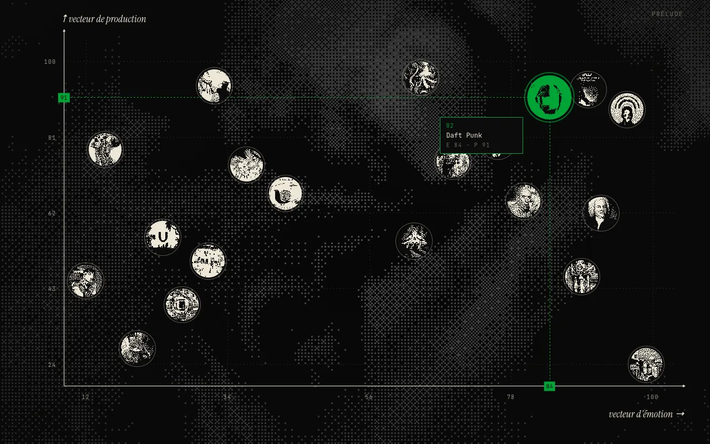

# Inspirations

Vingt inspirations placées sur un graphe : en x, l'émotion qu'elles procurent ;
en y, la part de mon travail qui y fait appel.

**En ligne :** https://inspirations-five.vercel.app



Chaque point ouvre une fiche : un texte, des images tramées, parfois un extrait
sonore et des liens vers l'œuvre. Les fiches se parcourent aussi au clavier
(flèches gauche et droite, Échap pour fermer).

## Technique

- React 19 et Vite, transitions avec Motion.
- Images tramées en 1 bit dans un canvas (diffusion d'erreur Atkinson), révélées
  selon une matrice de Bayer : `src/components/DitherImage.jsx`.
- Fond tramé animé en shader (three.js, React Three Fiber, postprocessing),
  mis en pause quand une fiche est ouverte ou quand le système demande moins
  d'animations.

## Lancer

```bash
npm install
npm run dev
```

## Ajouter le contenu

Tout se passe dans `src/data/inspirations2.js` (le format est décrit en tête du
fichier). Les images et vidéos vont dans `public/images` et `public/videos`,
les extraits sonores dans `public/musics`.

Couleurs : `src/theme.js`. Fond tramé : props de `<Dither>` dans `src/App.jsx`.

## Mettre en ligne sur Vercel

Importer le dossier sur vercel.com (ou `npx vercel`). Vite est détecté
automatiquement : build `npm run build`, sortie `dist`.

## Crédits

Les textes sont personnels. Les images restent la propriété de leurs auteurs et
ayants droit ; elles ne sont là que pour illustrer les œuvres commentées. Les
extraits sonores sont crédités dans les fiches, avec leur licence. Les
composants `Dither` et `DecryptedText` viennent de
[React Bits](https://reactbits.dev).
